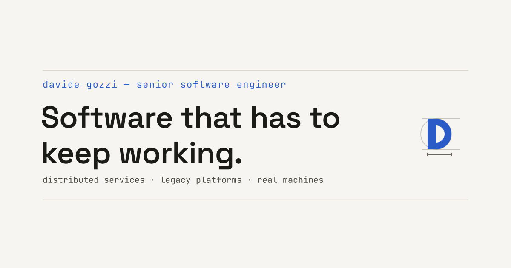

# Davide Gozzi — Engineering Portfolio

[Live portfolio](https://g4solio.github.io/portfolio/) ·
[CV](https://g4solio.github.io/portfolio/Davide_Gozzi_CV.pdf) ·
[LinkedIn](https://www.linkedin.com/in/davide-gozzi5/) ·
[GitHub](https://github.com/g4solio)



An industrial-editorial portfolio about software that has to keep working:
distributed services, legacy platforms, document systems, and applications
connected to real machines.

The site presents my professional experience as a series of first-person
chapters, with selected engineering decisions expanded into concise case
studies. OSUS closes the page as an independent product and engineering lab.

## What is inside

- Six professional chapters, from Unity development during high school to
  industrial software consulting.
- Four engineering notes covering real-time collision prediction,
  configuration-driven document schemas, backward-compatible distributed
  execution, and industrial quality data.
- An account of how I ship with AI agents doing most of the typing while the
  spec, architecture, review and CI enforcement stay mine, with CollectionVault
  as the worked example.
- OSUS projects, led by a live preview of RosettAI.
- A downloadable one-page CV and a verifiable EF SET English certificate.
- Meet, at `/meet/`: the intake desk of an officina for recruiters, thirteen
  questions asked plainly with the answers on a drafting board, a fact about me
  off the key board after each one, and the job card as the role brief they mail
  me. The earlier transcript game stays as its text mode.

## Design direction

The visual system is deliberately closer to an engineering casebook than a
developer dashboard:

- warm paper ground and ink typography;
- one drawing-blue accent;
- hairline rules instead of card-heavy UI;
- chapter-specific editorial layouts;
- diagrams used to explain decisions, not decorate the page;
- motion that drafts rather than fades: a casebook is pencilled, then inked,
  with no scroll hijacking and nothing gated behind animation.

The opening boot sequence lasts about 2.5 seconds, runs once per browser
session, is immediately skippable, and collapses onto the header's hairline.
After it the mark constructs itself, the wordmark is traced from the font's
outlines and inked, the statement is typed, and hairlines, chapter numbers and
schematics draw themselves as they enter. Reduced motion makes all of it
instant.

The identity is recorded as a design system ("Casebook") and as
`brand/tokens.json`, the single source for the site's colors and every brand
asset.

## Technology

- Next.js and React
- TypeScript
- Anime.js for progressive motion
- Static export
- GitHub Actions and GitHub Pages
- Self-hosted Space Grotesk, Inter, and JetBrains Mono fonts

The project has no backend dependency and requires no runtime secrets.

## Run locally

```bash
npm ci
npm run dev
```

Open `http://localhost:3000`.

## Quality checks

```bash
npm run lint
npm run build
node scripts/meet-check.mjs
```

The production build is exported to `out/`.

Regenerate the brand assets (the Open Graph image, the LinkedIn banner, the X
header, the GitHub banners in Paper and Ink, the repository social previews,
the avatars) from `brand/tokens.json` with:

```bash
npm run brand
```

Colors change in `brand/tokens.json`; `npm run tokens` rewrites `app/tokens.css`
and runs before every build. If the name or the display face changes,
`npm run wordmark` regenerates the traced wordmark.

Regenerate the CV (needs [WeasyPrint](https://weasyprint.org/) and the Inter
font family installed) with:

```bash
npm run cv
```

The source is `scripts/cv/Davide_Gozzi_CV.html`. The PDF must stay one page;
check it after every edit.

## Deployment

The workflow in `.github/workflows/deploy-pages.yml` builds and publishes the
static export whenever `main` is updated.

GitHub Pages must use **GitHub Actions** as its publishing source.

`next.config.ts` derives the correct `basePath` and `assetPrefix` from
`GITHUB_REPOSITORY`, allowing the same project to work as either a user site or
a repository site.

## Project map

```text
app/
  fonts/                  self-hosted variable fonts
  globals.css             visual system, motion and responsive layout
  tokens.css              generated from brand/tokens.json
  layout.tsx              metadata and social preview configuration
  meet/page.tsx           the recruiters' intake desk, /meet/

brand/
  tokens.json             the casebook's colors, Paper and Ink

components/
  BootSequence.tsx        session boot and wordmark hand-off
  Chapters.tsx            professional chapter layouts
  Mark.tsx                the mark, drawn as a casebook figure
  Meet.tsx                /meet/ with JavaScript: the desk, or text mode
  MeetDesk.tsx            the desk: the wall, the key board, the drafting board, the job card, the counter
  MeetTranscript.tsx      the transcript game, now text mode: status line, log, commands, prompt
  meet/art.ts             the desk's drawn things as SVG: keys, window, clock, cat, stickers, the pencil ring
  meet/Typed.tsx          the transcript's typed reveal and its links
  PortfolioPage.tsx       page structure, main copy and the drafting motion
  Schematic.tsx           inline engineering diagrams
  wordmark.generated.ts   the wordmark's letter outlines (npm run wordmark)

data/
  portfolio.ts            experience, decisions, and OSUS project data
  meet.ts                 the scope, the thirteen moves and their sheet names, the facts, the brief

public/
  Davide_Gozzi_CV.pdf     downloadable one-page CV
  brand/                  rendered banners, previews and avatars, served with the site
  og.png                  social preview image

scripts/
  brand.mjs               brand asset generator
  cv/Davide_Gozzi_CV.html CV source, rendered to public/Davide_Gozzi_CV.pdf
  meet-check.mjs          the one check for /meet/: scoring and the brief
  fonts/                  the static 600 weight of Space Grotesk, for the wordmark and the CV
  tokens.mjs              writes app/tokens.css from brand/tokens.json
  wordmark.mjs            traces the wordmark from the font's outlines
```

## Accessibility and resilience

- Semantic HTML and a skip link.
- Native `<details>` and `<summary>` for expandable engineering notes.
- Full keyboard navigation.
- `prefers-reduced-motion` support.
- No content is gated behind animation.
- Without JavaScript, the complete page remains readable and the boot overlay
  does not appear.
- Fonts are self-hosted and make no external requests.

## Content principles

The portfolio intentionally avoids invented metrics and exaggerated ownership.

Professional diagrams are reconstructed to explain engineering decisions
without exposing client source code, confidential infrastructure, credentials,
or internal data. Client and product names are used only where cleared for
public presentation.

The EF SET credential is described precisely as **C2 English comprehension**;
the linked certificate covers reading and listening.

## License

Copyright © 2026 Davide Gozzi. All rights reserved.

The repository is public for review and portfolio transparency. No license is
granted for reuse of its source code, design, writing, diagrams, or other
content unless explicitly agreed in writing.
